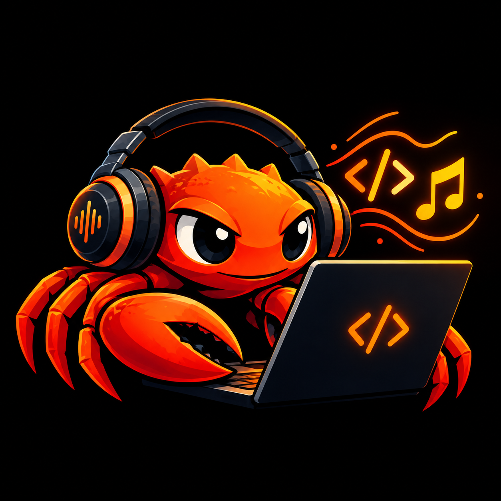

# Aratu

<p align="center">
  
</p>

**A live-coding language that reads like music.** Part of the
[Manguebyte](https://github.com/alessonqueirozdev-hub/manguebyte) ecosystem.

*Aratu is a crab of the mangrove, the mangue of Recife that gave
manguebeat, and Manguebyte, their names.*

Aratu is a live-coding language and environment for people who know
music: measures, time signatures, note values and tempo come first, so that
what you type is laid out in time the way a musician already thinks about
it. It is built on [Manguebyte](https://github.com/alessonqueirozdev-hub/manguebyte),
the open-source audio framework for Rust, and runs on its own or inside a
DAW, in step with the host's transport.

> **Status: in development.** The language crate (`crates/aratu`) reads,
> checks and schedules every example in the manual, and the web editor plays
> pieces with simple built-in sounds and takes edits at the next bar line.
> The sound engine will be Manguebyte once it runs in the browser. See
> [docs/VISION.md](docs/VISION.md) for where it is going.

## Running the editor

You need Rust (with `rustup target add wasm32-unknown-unknown`) and Node.

```
cd web
npm install
npm run dev
```

Then open <http://localhost:5173>. `Ctrl+Enter` plays or updates, `Ctrl+.`
stops, and any edit while it plays comes in at the next bar line.

## A taste

```
meter: 4/4
tempo: 96
key: A minor

drums {
  hh = cc cc co cc
  bd = b - b -
  sd = - s - s
}

bass = | a2 _ e2 _ | f2 _ c3 _ |

guitar {
  chords = | Am | F | C G | G |
  strum  = D du -u du
}
```

A space separates beats, symbols written together share their beat (`cc`
is two eighths), `_` holds and `-` rests. Chords are written as a lead
sheet, strums with `d` and `u`, dynamics and repeats with the score's own
signs, and note names in solfège (`dó4 ré4 mi4`) work as well as letters.
When a bar does not add up, Aratu says so in a musician's words, in
Portuguese or English: *"o compasso 2 de `bass` tem 5 tempos, mas a fórmula
de compasso é 4/4"*.

## The Manguebyte ecosystem

Aratu is one of three projects that grow from the same mangue:

| Project | What it is | How it meets Aratu |
|---|---|---|
| [Manguebyte](https://github.com/alessonqueirozdev-hub/manguebyte) | the open-source audio framework for Rust (MIT OR Apache-2.0) | Aratu's sound engine: synthesis, effects, the SFZ sampler, plugin hosting and the DAW wrappers |
| **Aratu** | this language and its editor | |
| Parabolic | a plugin and sampler generator for musicians | its instruments play in Aratu as plugins on a desktop or as SFZ in a browser |

Manguebyte's website (being built) will present all three together, each
linking to the others.

## Documents

- [docs/MANUAL.md](docs/MANUAL.md): the manual, a draft written from the design so far:
  rhythm, drums, melodies, chords and strumming, dynamics, tempo, feel,
  patterns, live playing, transformations, sound, and a quick reference.
- [docs/DESIGN-NOTES.md](docs/DESIGN-NOTES.md): syntax discussion and recommendations
  (no program ceremony, one pattern line per bar, numbers as controls).
- [docs/VISION.md](docs/VISION.md): the problem with time in today's
  live-coding languages, the principles, the language sketch, how it would
  run on Manguebyte, and what the first version contains.

## Licence

Licensed under either of [Apache License, Version 2.0](LICENSE-APACHE) or
[MIT license](LICENSE-MIT) at your option, like Manguebyte.
